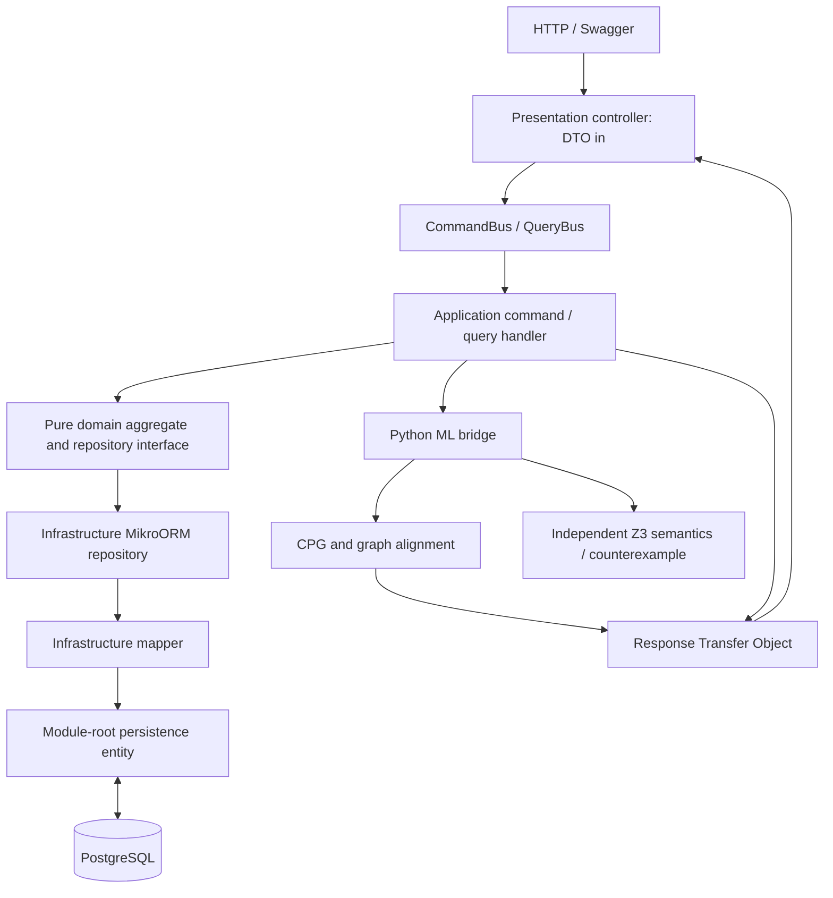

# SOTONSHIP — Neuro-Symbolic Financial Verifier

A runnable backend and ML prototype for comparing selected COBOL banking arithmetic with migrated Java. It extracts code property graphs, aligns structural features, scores financial risks and asks Z3 for counterexamples or equivalence within an explicit arithmetic model. There is no frontend; `frontend/` contains only `.gitkeep`.

The API uses **NestJS, strict Layered DDD, CQRS, MikroORM and PostgreSQL**. Python uses NetworkX, NumPy graph message passing, demo XGBoost risk scoring and `z3-solver`. Four precomputed analyses are loaded by an idempotent MikroORM seeder.

## What this prototype does

The hackathon idea is a review gate for COBOL-to-Java migration: a developer supplies the original COBOL and a Java candidate, the verifier checks the supported financial calculation, and an engineer receives evidence to inspect. It currently **verifies supplied code; it does not translate code**. The four supplied Java patches are generated fixtures, not dynamically generated fixes.

COBOL paragraphs and Java methods are graph nodes. Variables, expressions, calls, control flow and typed reads/writes connect them. Deterministic diagnostics flag such differences as packed decimal becoming `double` or changed arithmetic operators. A small experimental GCN suggests paragraph-to-method matches; Z3 independently compares the recognized source semantics. Neural scores never remove proof obligations or certify a candidate.

The useful demo is: find a concrete penny discrepancy, inspect the inputs/outputs and code locations, submit revised Java, and apply it only after a fresh proof within the recorded scope. Unsupported code produces `UNKNOWN` with an explanation. Every report starts with human review `PENDING`; this prototype does not implement reviewer sign-off or production deployment.

A provider-neutral generation port and environment placeholders are included for a future translation step. No LLM provider, model or network API is connected. Setting a key does not enable generation. A future adapter must return a candidate plus assumptions and unsupported constructs; the independent verifier remains responsible for the verdict.

## Run locally

Requires Node.js 22+, Python 3.11–3.13, and Docker Compose (or an existing PostgreSQL database). Run commands from the repository root unless shown otherwise.

```sh
cp .env.example .env
docker compose up -d --wait postgres

python3 -m venv ml-engine/.venv
ml-engine/.venv/bin/python -m pip install -r ml-engine/requirements.txt

cd backend
npm ci
npm run build
npm run setup
npm run start
```

`setup` runs migrations and seeds the four stored analyses and reference FX rows. It preserves existing verification rows, including applied patches. The API listens on **http://localhost:3001/api/verifications**; Swagger is at **http://localhost:3001/api/docs**. `npm run start:dev` runs TypeScript directly. Database credentials, port, Python executable and engine path are configured in the root `.env`; `backend/.env` can override them. With an existing database, set `DATABASE_URL` and skip the Docker command.

The committed seed JSON is available immediately, so no upload or model training is required. Python dependencies are required for new analyses and patch re-verification. A missing engine or solver error produces an infrastructure error, never a successful proof.

```sh
curl http://localhost:3001/api/verifications
curl http://localhost:3001/api/verifications/baseline-comparison
curl http://localhost:3001/api/fx-rates
```

Stop PostgreSQL with `docker compose down`. Its named volume retains local data. Rebuilding the database is unnecessary for normal restarts.

## Layered DDD and CQRS



Both `backend/src/modules/verification/` and `fx-rates/` use these boundaries:

| Layer | Folders | Responsibility |
| --- | --- | --- |
| Presentation | `presentation/controllers`, `dto`, `rto` | HTTP validation, Swagger, DTO input, bus dispatch and RTO output. |
| Application | `application/commands/handlers`, `queries/handlers`, `services` | Mutations as commands, reads as queries; orchestration, errors, events and RTO construction. |
| Domain | `domain/entities`, `value-objects`, `repositories`, `events`, `enums` | Framework-free aggregates, invariants and repository interfaces. |
| Infrastructure | `infrastructure/repositories`, `mappers`, `ml-bridge` | MikroORM repositories, explicit domain/persistence mapping and subprocess bridge. |
| Persistence | module-root `entities/*.entity.ts` | MikroORM decorators and PostgreSQL schema, separate from domain entities. |
| Shared | `backend/src/common/` | Exceptions/filter, translation keys, shared values/RTOs, migrations and seeders. |

Controllers do not call repositories. Handlers inject domain ports such as `@Inject('IVerificationRepository')`; infrastructure implements them. Domain code imports neither NestJS nor MikroORM. Only the infrastructure mapper converts persistence models to/from domain models. Compiled ORM discovery uses `dist/**/entities/*.entity.js`, with a corresponding TypeScript pattern for development. There is no TypeORM dependency.

The verification aggregate stores COBOL, Java and proposed patched Java; graph/alignment/risk results; a deterministic baseline; formal proof status; counterexamples; timestamps; and explicit proof scope/provenance. PostgreSQL uses UUID keys, JSONB graphs/witnesses/scope and decimal FX rates serialized as strings. A successful patch command re-verifies the supplied patch, requires a current-engine, supported, bounded `UNSAT_PROVEN_SAFE` result tied to the exact source SHA256 hashes, and then persists the new Java and fresh results. Unsupported or failing patches leave the original Java unchanged; optimistic version locking rejects conflicting updates. Completion and discrepancy events are published through CQRS.

| HTTP endpoint | CQRS use case | Response |
| --- | --- | --- |
| `GET /api/verifications` | `GetVerificationsListQuery` | `VerificationSummaryRto[]` |
| `GET /api/verifications/baseline-comparison` | `GetBaselineComparisonMetricsQuery` | `BaselineComparisonRto` |
| `GET /api/verifications/:id` | `GetVerificationDetailQuery` | `VerificationDetailRto` |
| `POST /api/verifications` | `RunVerificationCommand` | `VerificationDetailRto` |
| `POST /api/verifications/:id/reverify` | `ReverifyVerificationCommand` | Fresh analysis of current Java |
| `POST /api/verifications/:id/candidates` | `SubmitCandidateCommand` | Separately verified candidate; current Java/proof retained |
| `GET /api/verifications/:id/review` | `GetVerificationReviewQuery` | Engineer report and optional candidate analysis |
| `GET /api/verifications/:id/history` | `GetVerificationHistoryQuery` | Versioned source/analysis snapshots |
| `GET /api/generation/configuration` | `GetGenerationConfigurationQuery` | Presence flags; adapter always disabled |
| `POST /api/verifications/:id/apply-patch` | `ApplyVerifiedPatchCommand` | `VerificationDetailRto` |
| `GET /api/fx-rates` | FX list query | Reference FX RTOs |

Use Swagger for request schemas. A run accepts `moduleName`, `category`, `cobolSource`, `javaSource` and optional `patchedJavaSource`. Categories are `FX_CONVERSION`, `INTEREST_CALC`, `REMITTANCE_FEE` and `EXTERNAL_LIMIT_CASE`. UUIDs, DTO fields and shared source limits are validated: 100,000 characters and 1,500 lines per source, with a 1 MiB JSON body cap. Oversized source input returns HTTP 400; oversized JSON returns 413. Submitted source is parsed as data; the bridge does not execute submitted COBOL or Java.

## ML and formal pipeline

`ml-engine/ml_engine/` separates three stages:

1. `cpg_builder.py` uses the closed semantic AST for supported sources. Graphs retain real paragraphs/methods, typed declarations, expression operands, `READS`, `WRITES`, `DATA_FLOW`, `TYPE_FLOW`, `CFG` and `CALL` edges. Unsupported sources get an explicitly labeled structural approximation. Source line locations are inspection hints, not a proven defect localization.
2. `gnn_aligner.py` runs sparse normalized message passing through saved `8→12→8` demo weights, cosine paragraph-to-method matching and synthetic-trained node risk classification. Missing method/paragraph nodes produce a missing-alignment status, zero alignment and no fabricated root-node match. Deterministic type/operator warnings are labeled separately from neural scores.
3. `z3_formal_prover.py` independently parses complete sources, models scaled integers/rationals, storage-width truncation and supported Java arithmetic, and asserts unequal outputs. Exact source programs, the selected fixed rate and input bounds determine constraints. GNN alignment is advisory and does not select or prune the symbolic proof.

The scalar proof input contract maps the first two COBOL fields to amount and rate, and the two Java method parameters to the same roles. COBOL storage declarations require explicit `VALUE 0`; the harness supplies the two inputs. Supported grammar, bounds and exclusions are recorded with each result. Unknown statements, external state or unsupported semantics halt proof. These are deliberately small programs, not a complete COBOL compiler, Java frontend or general program equivalence system.

| Status | Meaning |
| --- | --- |
| `SAT_COUNTEREXAMPLE_FOUND` | Z3 found a concrete input for which modeled outputs differ. The stored witness includes exact decimal inputs/outputs and drift. |
| `UNSAT_PROVEN_SAFE` | No unequal outputs exist **within the recorded model, bounds, input contract and fixed reference rate**. This does not prove unrestricted whole-language or production banking equivalence. |
| `UNKNOWN_HALTED_LIMIT` | Unsupported code, external CICS/JCL state, unmodeled aliases, solver limits or insufficient modeling prevents a claim. Human review is required. |

The graph model suggests structurally similar, renamed code matches; it is not mathematically required to solve every equivalence problem. The shipped model is trained/calibrated on synthetic feature rows, not a labeled COBOL/Java mapping corpus. Its weights predate the revised AST graph extractor, so cross-language ranking quality remains unvalidated. Its confidence scores are not established real-world bug probabilities. There is no independently measured claim of **94% vs 18% accuracy**, and warm inference timing must be distinguished from Python startup, model loading and SMT proof time.

## Engineer workflow and future LLM configuration

1. `POST /api/verifications` with COBOL and Java, or start with one of the four seed IDs from `GET /api/verifications`.
2. `GET /api/verifications/:id/review`. Inspect `currentReport`: proof status and scope, concrete witnesses, deterministic diagnostics, relevant locations, limitations and suggested next steps. `SAT` and `UNKNOWN` require review. A scoped `UNSAT` is ready for review and still requires a human decision.
3. `POST /api/verifications/:id/candidates` with `{ "javaSource": "...revised Java..." }`. The response retains current Java and its verdict; `provenanceJson.candidateReview.analysis` contains the candidate's independent result. An unsafe candidate can be retained for inspection.
4. `POST /api/verifications/:id/apply-patch`. The server re-verifies the exact stored candidate and replaces Java only for a current, source-bound, bounded `UNSAT`. `SAT`/`UNKNOWN` returns 422 without replacing current Java. Read `GET /api/verifications/:id/history` to inspect prior versions.

Every successful API mutation and CLI `--persist` writes an immutable application revision in the same database transaction. This is local review history, not a tamper-proof compliance log. Legacy/seed rows receive a baseline snapshot on their first mutation; history before this feature was introduced cannot be reconstructed. Conflicting source/version updates return 409 in the API. Failed analyses do not create a saved revision; unsafe candidates can be saved using the candidate endpoint.

Results retain engine and semantics versions. `analysisStale` / `reVerificationRequired` flags mean a stored analysis requires `POST /api/verifications/:id/reverify`; reseeding deliberately preserves existing rows. Stale analyses are excluded from current proof counts in baseline-comparison metrics. The shared root `verification-policy.json` defines engine versions, source/body limits, nesting/graph budgets, expanded COBOL execution work and solver timeout. Keep it alongside both services when packaging the repository. Resource or unsupported-semantics limits return `UNKNOWN`, rather than proof success.

The reserved root `.env` settings are `LLM_API_KEY`, `LLM_PROVIDER`, `LLM_MODEL` and `LLM_BASE_URL`. Leave them empty until an adapter is implemented. `GET /api/generation/configuration` reports only presence booleans and `adapterEnabled: false`; it never returns credential values. No generation endpoint is advertised and no provider dependency is installed.

For judging, demonstrate the verified penny witness, safe candidate gate, revision history, and honest CICS failure case. Further work includes a selected LLM adapter, independent COBOL compiler differential checks across the supported subset, broader language frontends, and a labeled real-code alignment benchmark. GNN accuracy or production banking safety should not be claimed from the four demo cases.

## Four seed scenarios

| Module | Initial result | Demonstration |
| --- | --- | --- |
| `FX-WIRE-CALC.cbl` | `SAT_COUNTEREXAMPLE_FOUND` | Packed-decimal `ROUNDED` semantics versus Java floating arithmetic; solver-confirmed drift and a proposed BigDecimal fix. |
| `MORTGAGE-INT-CALC.cbl` | `SAT_COUNTEREXAMPLE_FOUND` | `PERFORM ... THRU` paragraph flow and `PIC 9(5)` width behavior missing from the migration. |
| `REMIT-TIER-FEE.cbl` | `UNSAT_PROVEN_SAFE` | Supported tiered remittance arithmetic preserved with BigDecimal and explicit rounding. |
| `CICS-TERMINAL-IO.cbl` | `UNKNOWN_HALTED_LIMIT` | External screen state and `REDEFINES` storage cannot be safely modeled; no patch is certified. |

The FX fixture has a concrete replayed counterexample: **GBP45.00 × 1.183 = EUR53.235**. COBOL `ROUNDED` produces **EUR53.24**; the migrated Java converts the binary `double` product using `new BigDecimal(double)` and rounds to **EUR53.23**. The witness is checked by Z3 and independently executed on the JVM. The patch accepts exact BigDecimal inputs and specifies `HALF_UP`, with the modeled COBOL storage cap preserved.

The supplied numerical example needed correction: `10450.33 × 1.2941 = 13523.772053`, and both ordinary decimal rounding and the straightforward double calculation give `13523.77`. That input is not a demonstrated penny counterexample. The supplied rate `1.2941` is also not asserted to be a Bank of England observation on 16 October 2026.

## Data sources, dates and licences

Collection date for this build: **17 October 2026** (Europe/London client date). Collection time and observation vintage are separate fields. Snapshot hashes and exact URLs are preserved in `data-sources/`; engine fixture provenance links to those records.

| Source | Included material and dates | Licence / attribution |
| --- | --- | --- |
| [IBM Bank of Z](https://github.com/IBM/Bank-of-Z) | Open-source banking COBOL reference samples at a pinned commit; retrieved 17 October 2026. These references are distinct from the generated four-case fixtures. | Apache License 2.0; retained upstream licence and source attribution. |
| [Bank of England IADB](https://www.bankofengland.co.uk/boeapps/database/) | Daily sterling exchange rates. Latest observation in the retrieved response requested through 17 October 2026 is **15 October 2026**: GBP/EUR **1.1830**, GBP/USD **1.3253**, GBP/THB **44.4158**. | [Open Government Licence v3.0](https://www.bankofengland.co.uk/legal), with Bank of England attribution; see the captured primary-source licence record. These are indicative published rates, not execution quotes. |
| [World Bank Remittance Prices Worldwide](https://remittanceprices.worldbank.org/corridor/United-Kingdom/Thailand) | Historical GBP→THB Wise Internet survey row for sending GBP120, surveyed **8–22 August 2025**: sender fee **GBP1.89**, displayed provider rate **43.98 THB/GBP**. Verified numeric extract collected 17 October 2026; direct download returned HTTP 403, recorded in the manifest. | [World Bank dataset licence CC BY 4.0](https://datacatalog.worldbank.org/search/dataset/0037898/remittance-prices-worldwide), subject to the recorded dataset terms and third-party exceptions. Attribution: The World Bank, Remittance Prices Worldwide. |

World Bank remittance fees, total costs and provider FX quotes describe a specific corridor/provider/quarter. Total cost percentages are not interchangeable with central-bank spot FX rates. A Bank of England GBP/THB spot rate retains BoE attribution even when used in a remittance example. Neither the fixture fee schedule nor a provider quote is described as a current universal remittance tariff. If a requested corridor is absent from a retrieved release, that absence must be reported rather than filled with invented observations.

The four COBOL/Java source pairs are **AI-generated educational fixtures**, inspired by banking patterns. They are not represented as extracted production bank programs. Upstream COBOL references and downloaded financial observations are attributed separately. All newly introduced application code, parsers, model generation/training code, tests, proof summaries and documentation were AI-generated during this task and require human review. No pretrained production banking GNN, independently validated accuracy, or whole-program certification is claimed.

## Reproduce and test

```sh
cd ml-engine
.venv/bin/python -m pytest
# Recompute the committed analyses from source fixtures and reference observations:
.venv/bin/python -m ml_engine.precompute

# Database-backed verification (root .env or an explicitly exported DATABASE_URL):
.venv/bin/python -m ml_engine.verify --id <verification-uuid>
# Optionally persist fresh analysis to that existing row; concurrent edits are rejected:
.venv/bin/python -m ml_engine.verify --id <verification-uuid> --persist
# Read a JSON request from stdin, without database writes:
.venv/bin/python -m ml_engine.verify --stdin < request.json

cd ../backend
npm run build
npm test
# With the API running against a disposable local database; creates/patches test rows:
npm run test:smoke
# With DATABASE_URL pointing to the same disposable database:
node test/persistence.smoke.mjs
```

The stdin JSON contract is `{ moduleName, category, cobolSource, javaSource, patchedJavaSource, referenceFxRates }`, where FX rates are decimal strings with currency pair, source and collection date. The response includes graph data, scores, baseline, proof status, witnesses, proof scope and provenance. Stdout is reserved for machine-readable JSON; diagnostics go to stderr.

Saved model inference uses a portable evaluator for the trained XGBoost trees, so it needs no native XGBoost/OpenMP library. To regenerate the synthetic demonstration model, install `ml-engine/requirements-training.txt` and run `python scripts/train_demo_models.py` from `ml-engine/` (XGBoost training on macOS also requires `libomp`). The model JSON records training seed, synthetic sample split, calibration and limitations. Reported synthetic classification metrics measure that generated task; they do not measure real cross-language alignment accuracy.

Tests cover supported arithmetic/counterexamples, safe patches, negative rounding, renamed identifiers and rejection of unsupported programs, plus domain rules, CQRS orchestration and layer boundaries. The HTTP smoke check exercises Swagger, shared input validation, seeded reads, real Python/Z3 analysis, typed graphs, review reports, candidate isolation, revision history, safe-patch persistence and limit-case rejection against PostgreSQL. The repository tests independently execute Java fixtures on a JDK when available; a COBOL compiler oracle has not yet been run for this build. See the engine model metadata and individual run `proofScope` for the exact guarantees and exclusions.
