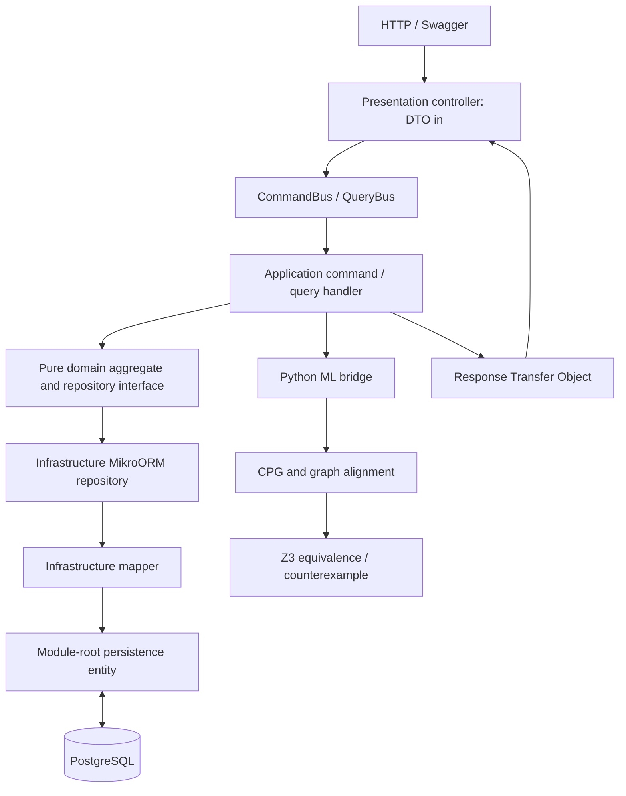

# SOTONSHIP — Learned COBOL-to-Java Matching and Financial Verification

An ML-led migration workbench for engineers comparing legacy COBOL with candidate Java implementations. A relation-aware Graph Neural Network ranks which Java programs correspond to a COBOL program. An engineer confirms the pairing and explicit input contract; an independent Z3 checker then looks for financial discrepancies in a supported bounded arithmetic subset.

The API uses **NestJS, strict Layered DDD, CQRS, MikroORM and PostgreSQL**. The Python engine uses NumPy for actual paired-source GNN training/inference and `z3-solver` for formal checks. The VS Code extension provides candidate ranking, manual confirmation, counterexamples, a native Java diff and fresh verification before an undoable editor change. `frontend/` contains only `.gitkeep`.

## MVP workflow

1. Select a COBOL program and up to 20 candidate Java implementations in VS Code.
2. The GNN ranks whole-program correspondences using source-derived operation/type/dependency graphs. Names, comments and task IDs are excluded from learned numeric features. Cosine scores are similarities, not correctness probabilities.
3. Inspect the ranked candidates and explicitly confirm one. A low-confidence or unsupported retrieval remains `REVIEW_REQUIRED`; the model does not approve migrations.
4. Supply the input/output mapping, financial bounds and exact reference-rate identity. Z3 independently returns a concrete counterexample, bounded equivalence evidence or `UNKNOWN`.
5. Supply a corrected Java candidate, inspect its diff and reverify. Applying it requires a fresh supported proof bound to the current source and contract.

**No LLM or external translation API is connected.** Candidate Java is supplied by the engineer. LLM generation/repair is planned; the implemented ML capability is program matching, not Java generation or exact fault localization.

## What the model has actually learned

The previous random-feature trainer, synthetic-risk XGBoost classifier and their model assets have been removed. The current GNN is fitted on a task-grouped subset of **143 COBOL-JavaTrans source pairs**, with separate validation and test tasks. These are small HumanEval-derived benchmark programs, not production banking migrations. Paired labels identify corresponding tasks; they do not certify unrestricted equivalence or identify faulty statements.

Training selects weights using validation retrieval results, then compares test retrieval against name matching, semantic-feature histograms and an independently trained model without message passing. The small GNN has **not established an advantage over the baselines**. Read the exact measured results, exclusions, split IDs and evaluation history in [the training report](ml-engine/evaluation/paired-code/training-report.json) and [model/evaluation guide](ml-engine/evaluation/README.md). Review is always required before verification; production reliability and financial-domain matching remain unvalidated.

Measured retrieval on the same 29 test tasks (29 Java candidates per query):

| Method | Correct first match | Correct match in top five |
| --- | --- | --- |
| Paired-program GNN | 11/29 (37.93%) | 20/29 (68.97%) |
| Learned encoder without message passing | 8/29 (27.59%) | 18/29 (62.07%) |
| Normalized-name baseline | 27/29 (93.10%) | 27/29 (93.10%) |

In a separately labelled controlled stress test on these same tasks, anonymizing Java declaration names leaves GNN scores unchanged while the name baseline falls to 1/29 Top-1. That removes the name baseline's input signal by design; it is not a new independent evaluation or production accuracy estimate. See [the stress report](ml-engine/evaluation/paired-code/rename-stress-report.json).

Compiler profiles and future conversion boundaries are documented in [docs/conversion-scope.md](docs/conversion-scope.md).

## Run locally

An optional [VS Code extension](vscode-extension/README.md) adds an editor workflow on top of this backend: select COBOL and Java documents, supply an explicit proof-input contract, inspect counterexamples in the workbench and Problems panel, compare a proposed fix in a native diff, and apply it only after fresh verification of the exact current source. Unsaved changes are included in verification; applying a fix remains undoable and does not save the file automatically. This client uses the same local API and bounded proof model. It does not generate Java or bundle PostgreSQL/Python.

For program matching, run **SOTONSHIP: Find Java Program Matches with GNN** and explicitly confirm a ranked candidate before providing the proof contract.

After starting the services below, run `npm ci`, `npm test` and `npm run package` from `vscode-extension/`, then install the resulting VSIX in VS Code and run **SOTONSHIP: Try the Penny Drift Demo**. Its default API address is `http://127.0.0.1:3001`; change `sotonship.backendUrl` when using another local port. See the extension README for custom files, proof mappings and native editor tests.

Requires Node.js 22+, Python 3.11–3.13, and Docker Compose (or an existing PostgreSQL database). Run commands from the repository root unless shown otherwise.

```sh
cp .env.example .env
docker compose up -d --wait postgres

python3 -m venv ml-engine/.venv
ml-engine/.venv/bin/python -m pip install -r ml-engine/requirements.txt

cd backend
npm ci
npm run build
npm run setup
npm run start
```

`setup` runs migrations and seeds the four stored analyses and reference FX rows. It preserves existing verification rows, including applied patches. The API listens on **http://localhost:3001/api/verifications**. Swagger is available on local nonproduction runs only when `SWAGGER_ENABLED=true`. API routes are available without credentials. `npm run start:dev` runs TypeScript directly. Database credentials, port, Python executable, worker limits and engine path are configured in the root `.env`; `backend/.env` can override them. With an existing database, set `DATABASE_URL` and skip the Docker command.

The committed seed JSON is available immediately, so no upload or model training is required. Python dependencies are required for new analyses and patch re-verification. A missing engine or solver error produces an infrastructure error, never a successful proof.

```sh
curl 'http://localhost:3001/api/verifications?page=1&pageSize=50'
curl http://localhost:3001/api/verifications/baseline-comparison
curl http://localhost:3001/api/fx-rates
```

Stop PostgreSQL with `docker compose down`. Its named volume retains local data. Rebuilding the database is unnecessary for normal restarts.

## Layered DDD and CQRS



Both `backend/src/modules/verification/` and `fx-rates/` use these boundaries:

| Layer | Folders | Responsibility |
| --- | --- | --- |
| Presentation | `presentation/controllers`, `dto`, `rto` | HTTP validation, Swagger, DTO input, bus dispatch and RTO output. |
| Application | `application/commands/handlers`, `queries/handlers`, `services` | Mutations as commands, reads as queries; orchestration, errors, events and RTO construction. |
| Domain | `domain/entities`, `value-objects`, `repositories`, `events`, `enums` | Framework-free aggregates, invariants and repository interfaces. |
| Infrastructure | `infrastructure/repositories`, `mappers`, `ml-bridge` | MikroORM repositories, explicit domain/persistence mapping and subprocess bridge. |
| Persistence | module-root `entities/*.entity.ts` | MikroORM decorators and PostgreSQL schema, separate from domain entities. |
| Shared | `backend/src/common/` | Exceptions/filter, translation keys, shared values/RTOs, migrations and seeders. |

Controllers do not call repositories. Handlers inject domain ports such as `@Inject('IVerificationRepository')`; infrastructure implements them. Domain code imports neither NestJS nor MikroORM. Only the infrastructure mapper converts persistence models to/from domain models. Compiled ORM discovery uses `dist/**/entities/*.entity.js`, with a corresponding TypeScript pattern for development. There is no TypeORM dependency.

The verification aggregate stores COBOL, Java and proposed patched Java; graph/alignment/risk results; a deterministic baseline; formal proof status; counterexamples; timestamps; and explicit proof scope/provenance. PostgreSQL uses UUID keys, JSONB graphs/witnesses/scope and decimal FX rates serialized as strings. A successful patch command re-verifies the supplied patch, requires a supported, bounded `UNSAT_PROVEN_SAFE` result tied to the exact source SHA256 hashes, and then persists the new Java and fresh results. Unsupported or failing patches leave the original Java unchanged; optimistic version locking rejects conflicting updates. Completion and discrepancy events are published through CQRS. Analysis subprocesses run through a bounded in-process asynchronous queue (`ML_WORKER_CONCURRENCY`, `ML_WORKER_QUEUE_LIMIT`); queued jobs are not durable across API restarts.

| HTTP endpoint | CQRS use case | Response |
| --- | --- | --- |
| `GET /api/verifications?page=1&pageSize=50` | `GetVerificationsListQuery` | `VerificationPageRto` with `items`, `page`, `pageSize`, `hasNext` |
| `GET /api/verifications/baseline-comparison` | `GetBaselineComparisonMetricsQuery` | `BaselineComparisonRto` |
| `GET /api/verifications/:id` | `GetVerificationDetailQuery` | `VerificationDetailRto` |
| `POST /api/verifications` | `RunVerificationCommand` | `VerificationDetailRto` |
| `POST /api/verifications/:id/apply-patch` | `ApplyVerifiedPatchCommand` | `VerificationDetailRto` |
| `GET /api/fx-rates` | FX list query | Reference FX RTOs |
| `POST /api/matches` | Read-only program-matching query | Ranked, source-bound candidate correspondences; no proof |

Use Swagger for request schemas. A run accepts `moduleName`, `category`, `cobolSource`, `javaSource`, and optional `patchedJavaSource`. Positive proof status also requires `proofInputs`: the declared `IBM_ENTERPRISE_COBOL_ZOS_6_5_SCALAR_SUBSET_V1` profile, source format, amount/rate/result fields, Java parameter names, cent bounds, and exact reference-rate currency pair/source/collection date. This is a verifier grammar label, not evidence that IBM compiled the source or that all compiler options are modeled. Missing or mismatched inputs return `UNKNOWN_HALTED_LIMIT`; no unrelated FX row is substituted. Supported COBOL source formats are `FREE` and a restricted fixed-format normalizer; continuation/debug lines and unsupported language features still halt proof. Categories are `FX_CONVERSION`, `INTEREST_CALC`, `REMITTANCE_FEE` and `EXTERNAL_LIMIT_CASE`. UUIDs, source length and DTO fields are validated. Submitted source is parsed as data; the bridge does not execute submitted COBOL or Java.

## ML matching and independent proof

`ml-engine/ml_engine/code_graph.py` extracts bounded, heuristic semantic-feature graphs with operations, types, literals and approximate data/control/sequence relationships. It is a retrieval representation, not a complete compiler or proof parser. `paired_gnn.py` applies two learned relation-specific message-passing layers, pools whole-program representations and scores candidates by cosine similarity. A paired-source contrastive objective teaches corresponding program vectors to approach each other; validation selects the checkpoint and suggestion gate.

`POST /api/matches` is a read-only CQRS query. It accepts `cobolSource`, optional `cobolSourceFormat` (`AUTO`, `FREE`, `FIXED`), `candidates: [{ candidateId, moduleName, javaSource }]` and optional `topK` (1–20, default 5). Responses include ranked candidate IDs and exact source hashes, model/dataset/evaluation provenance, similarity thresholds and `matchingIsProof: false`. This MVP does not persist match queries or assemble whole enterprise projects. Clients must explicitly confirm a candidate and provide a separate proof contract.

The source-inspection `cpg_builder.py` retains a line-oriented NetworkX graph for the verification report. The compatibility adapter emits only a program-to-program learned link, not inferred paragraph/method ground truth. No defect-risk classifier is shipped: `provenanceJson.riskAssessment.status` is `NOT_ESTIMATED`. The legacy numeric `gnnBugRiskScore` remains zero for storage/API compatibility and must not be interpreted as low risk.

`z3_formal_prover.py` independently parses a closed source grammar, models scaled integers/rationals, supported floating arithmetic and COBOL storage-width behavior, and asks whether outputs can differ. Learned scores never alter proof bounds, constraints or patch authorization. A successful proof is conditional on the recorded parser/model/input assumptions.

| Status | Meaning |
| --- | --- |
| `SAT_COUNTEREXAMPLE_FOUND` | Concrete inputs produce different modeled outputs. |
| `UNSAT_PROVEN_SAFE` | No differing observed outputs exist within the recorded supported model, bounds and fixed rate. |
| `UNKNOWN_HALTED_LIMIT` | Unsupported code, external state, missing contracts or solver/model limits prevent a conclusion. |

The proof grammar is deliberately narrow. It does not verify every program in the 143-task matching benchmark. Retrieval evaluation and supported financial proof scenarios measure different capabilities. Neither is production banking certification.

## Four seed scenarios

| Module | Initial result | Demonstration |
| --- | --- | --- |
| `FX-WIRE-CALC.cbl` | `SAT_COUNTEREXAMPLE_FOUND` | Packed-decimal `ROUNDED` semantics versus Java floating arithmetic; solver-confirmed drift and a proposed BigDecimal fix. |
| `MORTGAGE-INT-CALC.cbl` | `SAT_COUNTEREXAMPLE_FOUND` | `PERFORM ... THRU` paragraph flow and `PIC 9(5)` width behavior missing from the migration. |
| `REMIT-TIER-FEE.cbl` | `UNSAT_PROVEN_SAFE` | Supported tiered remittance arithmetic preserved with BigDecimal and explicit rounding. |
| `CICS-TERMINAL-IO.cbl` | `UNKNOWN_HALTED_LIMIT` | External screen state and `REDEFINES` storage cannot be safely modeled; no patch is certified. |

The FX fixture has a concrete replayed counterexample: **GBP45.00 × 1.183 = EUR53.235**. COBOL `ROUNDED` produces **EUR53.24**; the migrated Java converts the binary `double` product using `new BigDecimal(double)` and rounds to **EUR53.23**. The witness is checked by Z3 and independently executed on the JVM. The patch accepts exact BigDecimal inputs and specifies `HALF_UP`, with the modeled COBOL storage cap preserved.

The supplied numerical example needed correction: `10450.33 × 1.2941 = 13523.772053`, and both ordinary decimal rounding and the straightforward double calculation give `13523.77`. That input is not a demonstrated penny counterexample. The supplied rate `1.2941` is also not asserted to be a Bank of England observation on 16 October 2026.

## Data sources, dates and licences

Financial-reference collection date: **17 October 2026** (Europe/London client date). Collection time and observation vintage are separate fields. Snapshot hashes and exact URLs are preserved in `data-sources/`; engine fixture provenance links to those records.

| Source | Included material and dates | Licence / attribution |
| --- | --- | --- |
| [COBOL-JavaTrans](https://github.com/COBOL-Coder/COBOL-Coder) | 143 HumanEval-derived COBOL/Java task pairs at commit `2b14b7bf7e55556205654c6f7657fa60e36251fa`, collected **18 October 2026**. Used for paired matching, with task-grouped train/validation/test separation. | Repository Apache-2.0; underlying HumanEval task attribution MIT. Preserve upstream notices; see the [dataset manifest](ml-engine/evaluation/paired-code/dataset-manifest.json). |
| [IBM Bank of Z](https://github.com/IBM/Bank-of-Z) | Open-source banking COBOL reference samples at a pinned commit; retrieved 17 October 2026. These references are distinct from the generated four-case fixtures. | Apache License 2.0; retained upstream licence and source attribution. |
| [Bank of England IADB](https://www.bankofengland.co.uk/boeapps/database/) | Daily sterling exchange rates. Latest observation in the retrieved response requested through 17 October 2026 is **15 October 2026**: GBP/EUR **1.1830**, GBP/USD **1.3253**, GBP/THB **44.4158**. | [Open Government Licence v3.0](https://www.bankofengland.co.uk/legal), with Bank of England attribution; see the captured primary-source licence record. These are indicative published rates, not execution quotes. |
| [World Bank Remittance Prices Worldwide](https://remittanceprices.worldbank.org/corridor/United-Kingdom/Thailand) | Historical GBP→THB Wise Internet survey row for sending GBP120, surveyed **8–22 August 2025**: sender fee **GBP1.89**, displayed provider rate **43.98 THB/GBP**. Verified numeric extract collected 17 October 2026; direct download returned HTTP 403, recorded in the manifest. | [World Bank dataset licence CC BY 4.0](https://datacatalog.worldbank.org/search/dataset/0037898/remittance-prices-worldwide), subject to the recorded dataset terms and third-party exceptions. Attribution: The World Bank, Remittance Prices Worldwide. |

World Bank remittance fees, total costs and provider FX quotes describe a specific corridor/provider/quarter. Total cost percentages are not interchangeable with central-bank spot FX rates. A Bank of England GBP/THB spot rate retains BoE attribution even when used in a remittance example. Neither the fixture fee schedule nor a provider quote is described as a current universal remittance tariff. If a requested corridor is absent from a retrieved release, that absence must be reported rather than filled with invented observations.

The four COBOL/Java source pairs are **AI-generated educational fixtures**, inspired by banking patterns. They are not represented as extracted production bank programs. Upstream COBOL references and downloaded financial observations are attributed separately. All newly introduced application code, parsers, model generation/training code, tests, proof summaries and documentation were AI-generated during this task and require human review. No production banking GNN, validated financial defect probabilities, or unrestricted program certification is claimed. The paired-code benchmark has its separate measured retrieval results.

## Reproduce and test

```sh
cd ml-engine
.venv/bin/python -m pytest
# Recompute the committed analyses from source fixtures and reference observations:
.venv/bin/python -m ml_engine.precompute

# Database-backed verification (root .env or an explicitly exported DATABASE_URL):
.venv/bin/python -m ml_engine.verify --id <verification-uuid>
# Optionally persist fresh analysis to that existing row; concurrent edits are rejected:
.venv/bin/python -m ml_engine.verify --id <verification-uuid> --persist
# Read a JSON request from stdin, without database writes:
.venv/bin/python -m ml_engine.verify --stdin < request.json

cd ../backend
npm run build
npm test
# With the API running against a disposable local database; creates/patches test rows:
npm run test:smoke
```

The stdin JSON contract is `{ moduleName, category, cobolSource, javaSource, patchedJavaSource, referenceFxRates }`, where FX rates are decimal strings with currency pair, source and collection date. The response includes graph data, scores, baseline, proof status, witnesses, proof scope and provenance. Stdout is reserved for machine-readable JSON; diagnostics go to stderr.

Paired-model training and inference are portable NumPy; XGBoost, PyTorch, native OpenMP and external model APIs are not needed. From `ml-engine/`, reproduce the pinned corpus and training with:

```sh
.venv/bin/python scripts/fetch_paired_dataset.py
OPENBLAS_NUM_THREADS=1 .venv/bin/python scripts/train_paired_gnn.py
.venv/bin/python -m ml_engine.precompute
```

Raw benchmark sources are cached under ignored `ml-engine/evaluation/corpora/`. Commit-pinned URLs, collection date, SHA-256, licence notices, task-grouped splits and reports are retained separately. See [the evaluation guide](ml-engine/evaluation/README.md). The old node-risk evaluator refuses to misreport program-retrieval outputs as defect accuracy.

Tests cover supported arithmetic/counterexamples, safe patches, negative rounding, renamed identifiers and rejection of unsupported programs, plus domain rules, CQRS orchestration and layer boundaries. The HTTP smoke check exercises Swagger, validation, seeded reads, real Python/Z3 analysis, safe-patch persistence and limit-case rejection against PostgreSQL. See the engine model metadata and individual run `proofScope` for the exact guarantees and exclusions.
