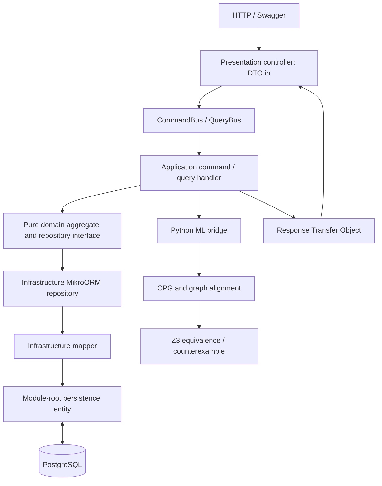

# SOTONSHIP — Neuro-Symbolic Financial Verifier

A runnable backend and ML prototype for comparing selected COBOL banking arithmetic with migrated Java. It extracts code property graphs, aligns structural features, scores financial risks and asks Z3 for counterexamples or equivalence within an explicit arithmetic model. There is no frontend; `frontend/` contains only `.gitkeep`.

The API uses **NestJS, strict Layered DDD, CQRS, MikroORM and PostgreSQL**. Python uses NetworkX, NumPy graph message passing, demo XGBoost risk scoring and `z3-solver`. Four precomputed analyses are loaded by an idempotent MikroORM seeder.

## Project background and design goals

The proposed compiler profiles, initial conversion boundary, evidence gates, and open enterprise controls are documented in [docs/conversion-scope.md](./docs/conversion-scope.md).

This overview records the project motivation and design goals. The implementation described below uses an explicit bounded scalar model and verifies caller-supplied patch candidates.

### The problem

Banks are modernising decades-old COBOL systems into Java, including software that calculates payments, interest, fees, and foreign-exchange conversions. A migration can compile, pass conventional tests, and still change the financial meaning of the original program.

For example, COBOL `COMP-3` values use fixed-point decimal arithmetic. Translating them into Java `double` values introduces binary floating-point behaviour, where common decimal values such as `0.1` cannot be represented exactly. Differences in scale, rounding order, digit truncation, or control flow can therefore create small discrepancies that are difficult to detect but significant across millions of transactions.

This is a real operational risk, not only a theoretical concern. In 2018, TSB's migration to a new banking platform caused widespread disruption, affected a significant proportion of its 5.2 million customers, led to £32.7 million in customer redress, and resulted in £48.65 million in regulatory fines. The incident was broader than a COBOL-to-Java conversion, but it demonstrates the cost of insufficient assurance during complex banking-system migrations. At the language level, [IBM documents `COMP-3` as fixed-point packed decimal](https://www.ibm.com/docs/en/cobol-linux-x86/1.2.0?topic=arithmetic-formats-numeric-data), while [Oracle documents the exact representation error produced from a Java `double`](https://docs.oracle.com/en/java/javase/18/docs/api/java.base/java/math/BigDecimal.html). These semantic differences cannot be addressed reliably through compilation and ordinary test cases alone.

### Our solution

We are building a verification layer that determines whether a migrated Java module preserves the financial behaviour of its COBOL source. Rather than trusting the translation process, the system combines machine learning with formal verification to identify risky changes and prove—or disprove—financial equivalence.

#### How it works

1. **Program modelling:** The COBOL and Java programs are converted into Code Property Graphs that capture syntax, data flow, control flow, types, and financial operations.
2. **Cross-language alignment:** A Graph Neural Network aligns equivalent COBOL paragraphs, variables, and operations with their Java counterparts, even when the code has been renamed or restructured. It assigns risk scores to suspicious mappings such as `COMP-3` to `double`, changed rounding rules, truncation, or altered loop behaviour.
3. **Focused formal verification:** The highest-risk aligned subgraphs are translated into mathematical constraints and checked with the Z3 theorem prover. Relevant Bank of England exchange rates and World Bank remittance-fee data provide realistic financial scenarios.
4. **Proof or counterexample:** If no differing result is possible within the defined model, the module is reported as mathematically equivalent. If a discrepancy exists, the verifier returns the exact input and the differing COBOL and Java outputs—for example, the transaction on which the Java implementation loses one penny.
5. **Verified remediation:** For supported decimal and rounding defects, the system proposes a Java `BigDecimal` correction and reruns the proof. Code that depends on unbounded external state, such as an unstubbed `EXEC CICS` call, is explicitly marked unverifiable and referred for human review.

### Why this solves the problem

Traditional compilers and linters check syntax and local rules; tests examine only selected examples. Our approach checks semantic behaviour across languages. The GNN makes verification practical by locating equivalent and high-risk logic after refactoring, while Z3 provides mathematical evidence and reproducible counterexamples. Together, they give migration teams a clear basis for approving safe modules, correcting unsafe ones, and refusing to make unsupported claims when verification is not possible.

### Evidence

- [FCA: TSB fined £48.65m for operational resilience failings](https://www.fca.org.uk/news/press-releases/tsb-fined-48m-operational-resilience-failings)
- [IBM: COBOL numeric data formats](https://www.ibm.com/docs/en/cobol-linux-x86/1.2.0?topic=arithmetic-formats-numeric-data)
- [Oracle: Java `BigDecimal` documentation](https://docs.oracle.com/en/java/javase/18/docs/api/java.base/java/math/BigDecimal.html)

## Run locally

Requires Node.js 22+, Python 3.11–3.13, and Docker Compose (or an existing PostgreSQL database). Run commands from the repository root unless shown otherwise.

```sh
cp .env.example .env
docker compose up -d --wait postgres

python3 -m venv ml-engine/.venv
ml-engine/.venv/bin/python -m pip install -r ml-engine/requirements.txt

cd backend
npm ci
npm run build
npm run setup
npm run start
```

`setup` runs migrations and seeds the four stored analyses and reference FX rows. It preserves existing verification rows, including applied patches. The API listens on **http://localhost:3001/api/verifications**. Swagger is available on local nonproduction runs only when `SWAGGER_ENABLED=true`. API routes require an RS256 Bearer token matching `AUTH_JWT_ISSUER`, `AUTH_JWT_AUDIENCE`, and `AUTH_JWT_PUBLIC_KEY`. Read routes require `verifications:read`; run and patch routes require `verifications:write`. Replace the example identity settings with an approved identity-provider configuration before use. `npm run start:dev` runs TypeScript directly. Database credentials, port, Python executable, worker limits and engine path are configured in the root `.env`; `backend/.env` can override them. With an existing database, set `DATABASE_URL` and skip the Docker command.

The committed seed JSON is available immediately, so no upload or model training is required. Python dependencies are required for new analyses and patch re-verification. A missing engine or solver error produces an infrastructure error, never a successful proof.

```sh
curl -H "Authorization: Bearer $API_BEARER_TOKEN" 'http://localhost:3001/api/verifications?page=1&pageSize=50'
curl -H "Authorization: Bearer $API_BEARER_TOKEN" http://localhost:3001/api/verifications/baseline-comparison
curl -H "Authorization: Bearer $API_BEARER_TOKEN" http://localhost:3001/api/fx-rates
```

Stop PostgreSQL with `docker compose down`. Its named volume retains local data. Rebuilding the database is unnecessary for normal restarts.

## Layered DDD and CQRS



Both `backend/src/modules/verification/` and `fx-rates/` use these boundaries:

| Layer | Folders | Responsibility |
| --- | --- | --- |
| Presentation | `presentation/controllers`, `dto`, `rto` | HTTP validation, Swagger, DTO input, bus dispatch and RTO output. |
| Application | `application/commands/handlers`, `queries/handlers`, `services` | Mutations as commands, reads as queries; orchestration, errors, events and RTO construction. |
| Domain | `domain/entities`, `value-objects`, `repositories`, `events`, `enums` | Framework-free aggregates, invariants and repository interfaces. |
| Infrastructure | `infrastructure/repositories`, `mappers`, `ml-bridge` | MikroORM repositories, explicit domain/persistence mapping and subprocess bridge. |
| Persistence | module-root `entities/*.entity.ts` | MikroORM decorators and PostgreSQL schema, separate from domain entities. |
| Shared | `backend/src/common/` | Exceptions/filter, translation keys, shared values/RTOs, migrations and seeders. |

Controllers do not call repositories. Handlers inject domain ports such as `@Inject('IVerificationRepository')`; infrastructure implements them. Domain code imports neither NestJS nor MikroORM. Only the infrastructure mapper converts persistence models to/from domain models. Compiled ORM discovery uses `dist/**/entities/*.entity.js`, with a corresponding TypeScript pattern for development. There is no TypeORM dependency.

The verification aggregate stores COBOL, Java and proposed patched Java; graph/alignment/risk results; a deterministic baseline; formal proof status; counterexamples; timestamps; and explicit proof scope/provenance. PostgreSQL uses UUID keys, JSONB graphs/witnesses/scope and decimal FX rates serialized as strings. A successful patch command re-verifies the supplied patch, requires a supported, bounded `UNSAT_PROVEN_SAFE` result tied to the exact source SHA256 hashes, and then persists the new Java and fresh results. Unsupported or failing patches leave the original Java unchanged; optimistic version locking rejects conflicting updates. Completion and discrepancy events are published through CQRS. Analysis subprocesses run through a bounded in-process asynchronous queue (`ML_WORKER_CONCURRENCY`, `ML_WORKER_QUEUE_LIMIT`); queued jobs are not durable across API restarts.

| HTTP endpoint | CQRS use case | Response |
| --- | --- | --- |
| `GET /api/verifications?page=1&pageSize=50` | `GetVerificationsListQuery` | `VerificationPageRto` with `items`, `page`, `pageSize`, `hasNext` |
| `GET /api/verifications/baseline-comparison` | `GetBaselineComparisonMetricsQuery` | `BaselineComparisonRto` |
| `GET /api/verifications/:id` | `GetVerificationDetailQuery` | `VerificationDetailRto` |
| `POST /api/verifications` | `RunVerificationCommand` | `VerificationDetailRto` |
| `POST /api/verifications/:id/apply-patch` | `ApplyVerifiedPatchCommand` | `VerificationDetailRto` |
| `GET /api/fx-rates` | FX list query | Reference FX RTOs |

Use Swagger for request schemas. A run accepts `moduleName`, `category`, `cobolSource`, `javaSource`, and optional `patchedJavaSource`. Positive proof status also requires `proofInputs`: the declared `IBM_ENTERPRISE_COBOL_ZOS_6_5_SCALAR_SUBSET_V1` profile, source format, amount/rate/result fields, Java parameter names, cent bounds, and exact reference-rate currency pair/source/collection date. This is a verifier grammar label, not evidence that IBM compiled the source or that all compiler options are modeled. Missing or mismatched inputs return `UNKNOWN_HALTED_LIMIT`; no unrelated FX row is substituted. Supported COBOL source formats are `FREE` and a restricted fixed-format normalizer; continuation/debug lines and unsupported language features still halt proof. Categories are `FX_CONVERSION`, `INTEREST_CALC`, `REMITTANCE_FEE` and `EXTERNAL_LIMIT_CASE`. UUIDs, source length and DTO fields are validated. Submitted source is parsed as data; the bridge does not execute submitted COBOL or Java.

## ML and formal pipeline

`ml-engine/ml_engine/` separates three stages:

1. `cpg_builder.py` extracts AST, control-flow and type-flow nodes/edges, including `PIC`, `COMP-3`, paragraph flow, Java arithmetic and external nodes. Node features are fixed-point, IEEE754, BigDecimal, scale, rounding, branching, external calls and structural residual.
2. `gnn_aligner.py` runs two graph message-passing layers with saved demo weights, cosine subgraph alignment and node risk classification. The deterministic baseline matches names/regexes. Graph JSON includes cross-language links and node scores; an f-string explanation identifies structural/type risks and the proof outcome.
3. `z3_formal_prover.py` parses a closed source grammar, models scaled integers/rationals, storage-width truncation and the supported Java arithmetic, and asserts unequal results. The exact source programs, actual rate and input bounds determine the constraints. Neural scores do not establish formal safety.

The scalar proof input contract maps the first two COBOL fields to amount and rate, and the two Java method parameters to the same roles. COBOL storage declarations require explicit `VALUE 0`; the harness supplies the two inputs. Supported grammar, bounds and exclusions are recorded with each result. Unknown statements, external state or unsupported semantics halt proof. These are deliberately small programs, not a complete COBOL compiler, Java frontend or general program equivalence system.

| Status | Meaning |
| --- | --- |
| `SAT_COUNTEREXAMPLE_FOUND` | Z3 found a concrete input for which modeled outputs differ. The stored witness includes exact decimal inputs/outputs and drift. |
| `UNSAT_PROVEN_SAFE` | No unequal outputs exist **within the recorded model, bounds, input contract and fixed reference rate**. This does not prove unrestricted whole-language or production banking equivalence. |
| `UNKNOWN_HALTED_LIMIT` | Unsupported code, external CICS/JCL state, unmodeled aliases, solver limits or insufficient modeling prevents a claim. Human review is required. |

AI helps prioritize structurally similar, renamed code and highlight risk; it is not mathematically required to solve every equivalence problem. The shipped model is trained/calibrated on synthetic demo data. Each analysis now marks ML validation as `NOT_VALIDATED` until a representative, human-reviewed corpus is supplied. Its confidence scores are not established real-world bug probabilities. There is no independently measured claim of **94% vs 18% accuracy**, and warm inference timing must be distinguished from Python startup, model loading and SMT proof time.

The authorized-corpus schema, reviewer adjudication workflow, codebase-level holdout policy and baseline comparison tool are documented in [ml-engine/evaluation/README.md](./ml-engine/evaluation/README.md). The tool evaluates a frozen model and records misses; it does not train or change proof decisions. Production source must remain in an approved access-controlled corpus, outside this repository.

## Four seed scenarios

| Module | Initial result | Demonstration |
| --- | --- | --- |
| `FX-WIRE-CALC.cbl` | `SAT_COUNTEREXAMPLE_FOUND` | Packed-decimal `ROUNDED` semantics versus Java floating arithmetic; solver-confirmed drift and a proposed BigDecimal fix. |
| `MORTGAGE-INT-CALC.cbl` | `SAT_COUNTEREXAMPLE_FOUND` | `PERFORM ... THRU` paragraph flow and `PIC 9(5)` width behavior missing from the migration. |
| `REMIT-TIER-FEE.cbl` | `UNSAT_PROVEN_SAFE` | Supported tiered remittance arithmetic preserved with BigDecimal and explicit rounding. |
| `CICS-TERMINAL-IO.cbl` | `UNKNOWN_HALTED_LIMIT` | External screen state and `REDEFINES` storage cannot be safely modeled; no patch is certified. |

The FX fixture has a concrete replayed counterexample: **GBP45.00 × 1.183 = EUR53.235**. COBOL `ROUNDED` produces **EUR53.24**; the migrated Java converts the binary `double` product using `new BigDecimal(double)` and rounds to **EUR53.23**. The witness is checked by Z3 and independently executed on the JVM. The patch accepts exact BigDecimal inputs and specifies `HALF_UP`, with the modeled COBOL storage cap preserved.

The supplied numerical example needed correction: `10450.33 × 1.2941 = 13523.772053`, and both ordinary decimal rounding and the straightforward double calculation give `13523.77`. That input is not a demonstrated penny counterexample. The supplied rate `1.2941` is also not asserted to be a Bank of England observation on 16 October 2026.

## Data sources, dates and licences

Collection date for this build: **17 October 2026** (Europe/London client date). Collection time and observation vintage are separate fields. Snapshot hashes and exact URLs are preserved in `data-sources/`; engine fixture provenance links to those records.

| Source | Included material and dates | Licence / attribution |
| --- | --- | --- |
| [IBM Bank of Z](https://github.com/IBM/Bank-of-Z) | Open-source banking COBOL reference samples at a pinned commit; retrieved 17 October 2026. These references are distinct from the generated four-case fixtures. | Apache License 2.0; retained upstream licence and source attribution. |
| [Bank of England IADB](https://www.bankofengland.co.uk/boeapps/database/) | Daily sterling exchange rates. Latest observation in the retrieved response requested through 17 October 2026 is **15 October 2026**: GBP/EUR **1.1830**, GBP/USD **1.3253**, GBP/THB **44.4158**. | [Open Government Licence v3.0](https://www.bankofengland.co.uk/legal), with Bank of England attribution; see the captured primary-source licence record. These are indicative published rates, not execution quotes. |
| [World Bank Remittance Prices Worldwide](https://remittanceprices.worldbank.org/corridor/United-Kingdom/Thailand) | Historical GBP→THB Wise Internet survey row for sending GBP120, surveyed **8–22 August 2025**: sender fee **GBP1.89**, displayed provider rate **43.98 THB/GBP**. Verified numeric extract collected 17 October 2026; direct download returned HTTP 403, recorded in the manifest. | [World Bank dataset licence CC BY 4.0](https://datacatalog.worldbank.org/search/dataset/0037898/remittance-prices-worldwide), subject to the recorded dataset terms and third-party exceptions. Attribution: The World Bank, Remittance Prices Worldwide. |

World Bank remittance fees, total costs and provider FX quotes describe a specific corridor/provider/quarter. Total cost percentages are not interchangeable with central-bank spot FX rates. A Bank of England GBP/THB spot rate retains BoE attribution even when used in a remittance example. Neither the fixture fee schedule nor a provider quote is described as a current universal remittance tariff. If a requested corridor is absent from a retrieved release, that absence must be reported rather than filled with invented observations.

The four COBOL/Java source pairs are **AI-generated educational fixtures**, inspired by banking patterns. They are not represented as extracted production bank programs. Upstream COBOL references and downloaded financial observations are attributed separately. All newly introduced application code, parsers, model generation/training code, tests, proof summaries and documentation were AI-generated during this task and require human review. No pretrained production banking GNN, independently validated accuracy, or whole-program certification is claimed.

## Reproduce and test

```sh
cd ml-engine
.venv/bin/python -m pytest
# Recompute the committed analyses from source fixtures and reference observations:
.venv/bin/python -m ml_engine.precompute

# Database-backed verification (root .env or an explicitly exported DATABASE_URL):
.venv/bin/python -m ml_engine.verify --id <verification-uuid>
# Optionally persist fresh analysis to that existing row; concurrent edits are rejected:
.venv/bin/python -m ml_engine.verify --id <verification-uuid> --persist
# Read a JSON request from stdin, without database writes:
.venv/bin/python -m ml_engine.verify --stdin < request.json

cd ../backend
npm run build
npm test
# With the API running against a disposable local database; creates/patches test rows:
npm run test:smoke
```

The stdin JSON contract is `{ moduleName, category, cobolSource, javaSource, patchedJavaSource, referenceFxRates }`, where FX rates are decimal strings with currency pair, source and collection date. The response includes graph data, scores, baseline, proof status, witnesses, proof scope and provenance. Stdout is reserved for machine-readable JSON; diagnostics go to stderr.

Saved model inference uses a portable evaluator for the trained XGBoost trees, so it needs no native XGBoost/OpenMP library. To regenerate the synthetic demonstration model, install `ml-engine/requirements-training.txt` and run `python scripts/train_demo_models.py` from `ml-engine/` (XGBoost training on macOS also requires `libomp`). The model JSON records training seed, synthetic sample split, calibration and limitations. Reported synthetic classification metrics measure that generated task; they do not measure real cross-language alignment accuracy.

Tests cover supported arithmetic/counterexamples, safe patches, negative rounding, renamed identifiers and rejection of unsupported programs, plus domain rules, CQRS orchestration and layer boundaries. The HTTP smoke check exercises Swagger, validation, seeded reads, real Python/Z3 analysis, safe-patch persistence and limit-case rejection against PostgreSQL. See the engine model metadata and individual run `proofScope` for the exact guarantees and exclusions.
