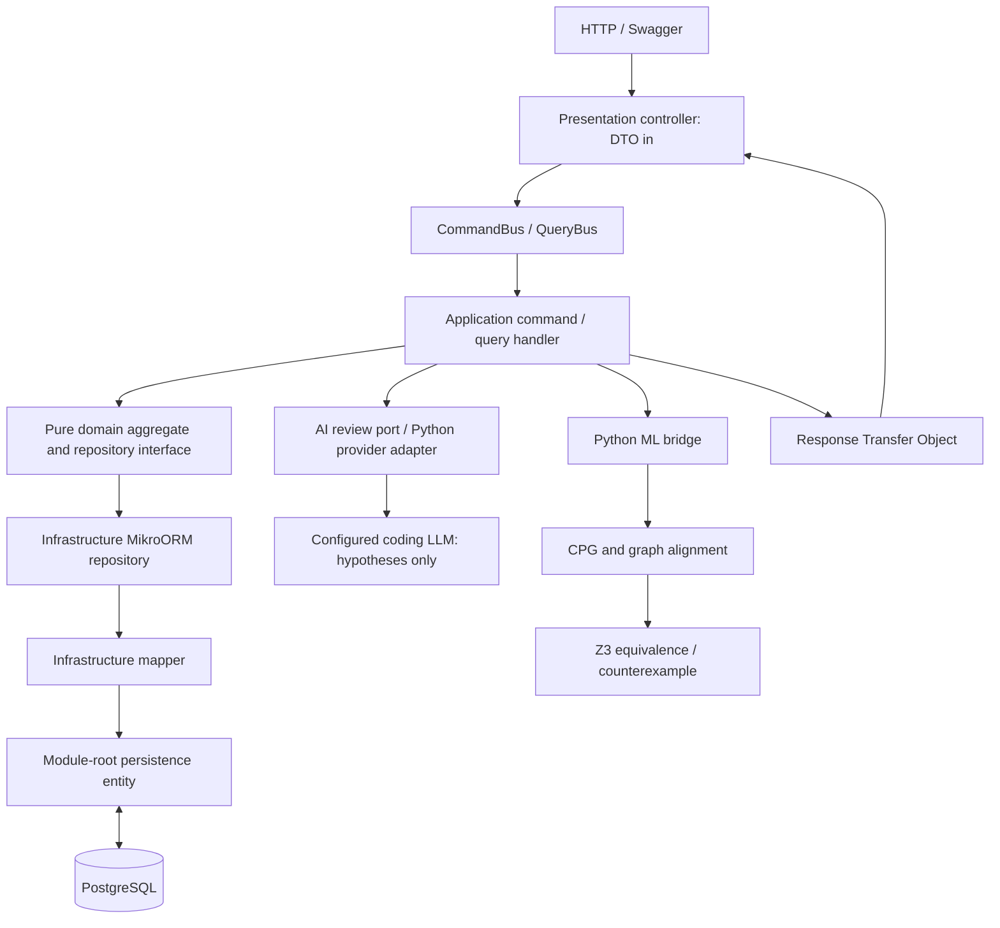

# Omul — Technical Guide

A migration workbench for engineers comparing legacy COBOL with its translated Java. The browser can run a **locally trained graph-feature defect classifier and source-location ranker**, with no API key. Findings mark the actual submitted source lines and remain hypotheses requiring review. An optional coding LLM provides a separate review. Independent runtime evidence and the bounded Z3 checker remain separate from both models. The existing GNN is an optional program-matching tool.

**The new detector failed its held-out pilot evaluation: 1/8 correct (12.5%), below both 50% baselines.** It is an experimental demonstration of the learned workflow, not a reliable migration verifier. The UI prominently displays the failure, false alarms and missed defects. Its default training example genuinely identifies Java line 10 and shows separately recorded COBOL `-100` versus Java `100`; success on a training example does not establish generalization. Read the [local detector guide](docs/local-defect-model.md) and [frozen experiment](ml-engine/evaluation/synthetic-pilot/defect-model-v1/README.md).

The API uses **NestJS, strict Layered DDD, CQRS, MikroORM and PostgreSQL**. Python provides portable NumPy defect inference, optional paired-source GNN matching, an OpenAI-compatible adapter and `z3-solver` checks. The browser supports the new local detector; the VS Code extension retains its separate configured-LLM review and verification workflow. `frontend/` contains only `.gitkeep`.

## MVP workflow

1. Open the local browser workbench at **http://127.0.0.1:3000** after starting the services below. It loads editable COBOL and Java with syntax highlighting and a source-bound, executed example.
2. Click **Run local defect model**. The backend parses this exact supplied pair and runs learned classifier/ranker weights locally. No provider credentials, dataset labels or test outputs are inference inputs. Submitted code is never executed.
3. Click a finding to select its source lines. Amber `MODEL_HYPOTHESIS` locations are distinct from red `CONFIRMED_REPLAY` evidence. The model can flag correct code or miss defects; an empty list is not equivalence.
4. Select **Reviewed correction** and rerun the model, or edit either source. Edits invalidate every earlier finding, proof and recorded witness. The control correction is prewritten, not automatically generated.
5. Select the FX example to exercise the supported bounded Z3 flow. The signed-balance example is outside that parser and remains `UNKNOWN`. An optional, explicitly requested cloud review stays separate. AI scores never authorize a patch or alter proof premises.

The local detector is shipped as trained JSON weights and requires no LLM API key. **Optional LLM review** requires server-side `LLM_MODEL` and provider credentials; missing configuration stays `NOT_CONFIGURED`. Java translation, automatic repair and execution of proposed inputs are not implemented. See [local model details](docs/local-defect-model.md) and [optional LLM configuration](docs/ai-defect-review.md).

## Optional program-matching model

The previous random-feature trainer and synthetic-risk XGBoost classifier were removed. The active **v4 regularized GNN ensemble** uses the pinned **143 COBOL-JavaTrans source pairs**, with **120 development pairs and 23 reserved evaluation pairs**. These are small HumanEval-derived benchmark programs, not banking migrations. Their labels identify corresponding tasks, not unrestricted equivalence or faulty statements.

The frozen [graph partition plan](ml-engine/evaluation/paired-code/cv-partition-plan.json) keeps related complete programs together. Both-language token similarity and relation-aware graph fingerprints form 142 connected components. Every candidate retains five models fitted on **96 pairs** and validated on **24** each, with **no final fit on all 120**. Runtime scores are the fixed equal mean of the five member cosine scores. Learned features exclude identifier spelling, comments and method/program/task names.

We trained four fixed improvements and a fresh baseline. Both checkpoints and the winning candidate were selected by pooled development-only out-of-fold **Top-1**, then **MRR**, with predeclared tie-breaks. All candidate weights and the CV winner were frozen before the one-shot 23-pair comparison. The selected graph-regularized model tied baseline CV Top-1 at **51/120 (42.50%)**, then won the MRR tie-break (**0.5658 vs 0.5583**) at epoch **80**.

| Model | CV Top-1 (120 queries) | Final Top-1 (23 queries) | Final Top-5 | Final MRR |
| --- | --- | --- | --- | --- |
| **Active: sequence-edge regularized GNN** | **51/120 (42.50%)** | **9/23 (39.13%)** | **17/23 (73.91%)** | **0.5633** |
| Separate COBOL/Java projection heads | 48/120 (40.00%) | 11/23 (47.83%) | 18/23 (78.26%) | 0.6088 |
| Count-aware multiscale GNN readout | 43/120 (35.83%) | 9/23 (39.13%) | 18/23 (78.26%) | 0.5329 |
| WL structural features + regularized CCA | 34/120 (28.33%) | 4/23 (17.39%) | 14/23 (60.87%) | 0.3921 |
| Fresh original GNN control | 51/120 (42.50%) | 7/23 (30.43%) | 16/23 (69.57%) | 0.4948 |
| Normalized-name baseline | — | 22/23 (95.65%) | 22/23 (95.65%) | 0.9588 |
| Semantic histogram | — | 6/23 (26.09%) | 10/23 (43.48%) | 0.3721 |

The active model gains **two correct first choices (+8.70 percentage points)** over the previous v3 ensemble/control on this reused evaluation gallery. Separate language heads have the highest observed final score among learned candidates, but deployment follows the pre-evaluation CV winner; selecting the final winner would contaminate the reserved evaluation. The small differences do not establish statistical significance or financial-domain generalization, and the name baseline remains substantially stronger with original names intact.

The changes are adaptations motivated by [Xu et al., ICLR 2019](https://arxiv.org/abs/1810.00826) (count-sensitive graph representations), [Andrew et al., ICML 2013](https://proceedings.mlr.press/v28/andrew13.html) (paired-view transformations), [Shervashidze et al., JMLR 2011](https://www.jmlr.org/papers/v12/shervashidze11a.html) (WL graph features), and [You et al., NeurIPS 2020](https://proceedings.neurips.cc/paper/2020/hash/3fe230348e9a12c13120749e3f9fa4cd-Abstract.html) (graph augmentation). They are not reproductions of GIN, DCCA or GraphCL, and the papers do not guarantee gains on this dataset. The regularizer drops 10% of auxiliary sequence links during fitting only; numeric features, data/control links and real pair labels remain intact. It does not create additional authentic source pairs.

**All 23 were previously evaluated in v1/v2/v3. This new protocol was requested after those results were known. They are excluded from every new fit, preprocessing estimate and model/checkpoint choice, but remain a reused benchmark, not pristine unforeseen data.** CV evaluates each development query only with its designated held-out member, not the other four that trained on it. Those figures are exploratory model-selection statistics, not an unbiased nested estimate of five-member ensemble performance; CV has 24 candidates per query, final evaluation 23. Every ranking still requires engineer confirmation.

Read the [v4 CV histories](ml-engine/evaluation/paired-code/cv-v4-candidates/cv-training-report.json), [all final per-query/member results](ml-engine/evaluation/paired-code/cv-v4-candidates/final-evaluation-report.json), [freeze record](ml-engine/evaluation/paired-code/cv-v4-candidates/model-freeze.json), [deployment manifest](ml-engine/evaluation/paired-code/cv-v4-candidates/deployment-manifest.json), and [evaluation guide](ml-engine/evaluation/README.md). Historical [v3](ml-engine/evaluation/paired-code/cv-v3-fold-ensemble/final-evaluation-report.json), [v2](ml-engine/evaluation/paired-code/cv-v2/final-evaluation-report.json), [v1 training](ml-engine/evaluation/paired-code/training-report.json) and [v1 rename-stress](ml-engine/evaluation/paired-code/rename-stress-report.json) reports remain preserved. Six former v1 test tasks now enter development; its old 29-task test gallery is not a valid v2/v3/v4 holdout.

Compiler profiles and future conversion boundaries are documented in [docs/conversion-scope.md](docs/conversion-scope.md).

The separate [self-trained synthetic defect pilot](ml-engine/evaluation/synthetic-pilot/defect-model-v1/README.md) now implements supplied-pair classification and location ranking. It uses different data, labels, weights and metrics from this matcher and did not generalize reliably. The [reviewed-defect catalogue](data-sources/reviewed-translation-defect-candidates.json) and [measurement draft](ml-engine/evaluation/defect-corpus/measurement-protocol-draft.json) remain a distinct natural-data effort. Matching accuracy must never be presented as verification or defect accuracy.

The [natural COBOL-to-Java execution audit](ml-engine/evaluation/defect-corpus/README.md) records published translation attempts and actual same-input discrepancies with pinned contracts and raw-evidence hashes. Java-only failures, reference/oracle disagreements and unresolved cases remain separate. Those exploratory observations are pending independent human review and were not used to train the synthetic detector. The original 23 reserved matching families remain separate.

The [expanded behavioral adjudication](ml-engine/evaluation/defect-corpus/expanded-c2j/README.md) gives every remaining flagged family an explicit disposition and expands the strong review queue to **six source tasks / six candidate programs**, with 25 original-input witnesses. Reference-policy conflicts and unsupported interfaces remain separate, and all human decisions are pending. These are selected corpus-curation results, not defect-detector accuracy.

## Interactive local browser workbench

The supplied-pair review also has a browser UI in `backend/dev-ui/`; `frontend/` remains empty. Start the Nest backend, then run from `backend/`:

```sh
npm run ui
```

Open **http://127.0.0.1:3000**. The UI proxies to `http://127.0.0.1:3003` by default; set `BACKEND_ORIGIN` to your backend (for example `BACKEND_ORIGIN=http://127.0.0.1:3001 npm run ui`). `UI_PORT` changes the UI port. It binds to loopback only.

The default signed-balance training example has an actual recorded mismatch: opening balance `500`, adjustment `-800`, fee `400` produce COBOL `-100` and Java `100`. The learned ranker independently prioritizes COBOL line 23 / Java line 10, where Java applies an erroneous final `.abs()`. The reviewed control prints `-100`. The example selector also retains the [one-cent FX fixture and bounded Z3 check](backend/dev-ui/data/README.md). These are AI-authored examples with real runtime observations, not discovered production-bank defects.

The local action sends source only to the local API; optional cloud review sends it to a configured provider only on its separate explicit action. Source changes hide old evidence. No API key is accepted or stored by the browser. Final test metrics are loaded from an exact-hash-bound aggregate report, not inferred from the working training example.

## Run locally

An optional [VS Code extension](vscode-extension/README.md) adds an editor workflow on top of this backend: select COBOL and Java documents, supply an explicit proof-input contract, inspect counterexamples in the workbench and Problems panel, compare a proposed fix in a native diff, and apply it only after fresh verification of the exact current source. Unsaved changes are included in verification; applying a fix remains undoable and does not save the file automatically. This client uses the same local API and bounded proof model. It does not generate Java or bundle PostgreSQL/Python.

For defect review, select the supplied pair and run **SOTONSHIP: Analyze Pair with AI** after configuring the backend as described in [AI review setup](docs/ai-defect-review.md). For optional program matching, run **SOTONSHIP: Find Java Program Matches with GNN** and explicitly confirm a ranked candidate before providing the proof contract.

After starting the services below, run `npm ci`, `npm test` and `npm run package` from `vscode-extension/`, then install the resulting VSIX in VS Code and run **SOTONSHIP: Try the Penny Drift Demo**. Its default API address is `http://127.0.0.1:3001`; change `sotonship.backendUrl` when using another local port. See the extension README for custom files, proof mappings and native editor tests.

Requires Node.js 22+, Python 3.11–3.13, and Docker Compose (or an existing PostgreSQL database). Run commands from the repository root unless shown otherwise.

```sh
cp .env.example .env
docker compose up -d --wait postgres

python3 -m venv ml-engine/.venv
ml-engine/.venv/bin/python -m pip install -r ml-engine/requirements.txt

cd backend
npm ci
npm run build
npm run setup
npm run start
```

`setup` runs migrations and seeds the four stored analyses and reference FX rows. It preserves existing verification rows, including applied patches. The API listens on **http://localhost:3001/api/verifications**. Swagger is available on local nonproduction runs only when `SWAGGER_ENABLED=true`. API routes are available without credentials. `npm run start:dev` runs TypeScript directly. Database credentials, port, Python executable, worker limits, engine path and optional LLM provider settings are configured in the root `.env`; `backend/.env` can override them. With an existing database, set `DATABASE_URL` and skip the Docker command.

The committed seed JSON is available immediately, so no upload or model training is required. Python dependencies are required for new analyses and patch re-verification. A missing engine or solver error produces an infrastructure error, never a successful proof.

```sh
curl 'http://localhost:3001/api/verifications?page=1&pageSize=50'
curl http://localhost:3001/api/verifications/baseline-comparison
curl http://localhost:3001/api/fx-rates
```

Stop PostgreSQL with `docker compose down`. Its named volume retains local data. Rebuilding the database is unnecessary for normal restarts.

## Layered DDD and CQRS



Both `backend/src/modules/verification/` and `fx-rates/` use these boundaries:

| Layer | Folders | Responsibility |
| --- | --- | --- |
| Presentation | `presentation/controllers`, `dto`, `rto` | HTTP validation, Swagger, DTO input, bus dispatch and RTO output. |
| Application | `application/commands/handlers`, `queries/handlers`, `services` | Mutations as commands, reads as queries; orchestration, errors, events and RTO construction. |
| Domain | `domain/entities`, `value-objects`, `repositories`, `events`, `enums` | Framework-free aggregates, invariants and repository interfaces. |
| Infrastructure | `infrastructure/repositories`, `mappers`, `ml-bridge` | MikroORM repositories, explicit domain/persistence mapping and subprocess bridge. |
| Persistence | module-root `entities/*.entity.ts` | MikroORM decorators and PostgreSQL schema, separate from domain entities. |
| Shared | `backend/src/common/` | Exceptions/filter, translation keys, shared values/RTOs, migrations and seeders. |

Controllers do not call repositories. Handlers inject domain ports such as `@Inject('IVerificationRepository')`; infrastructure implements them. Domain code imports neither NestJS nor MikroORM. Only the infrastructure mapper converts persistence models to/from domain models. Compiled ORM discovery uses `dist/**/entities/*.entity.js`, with a corresponding TypeScript pattern for development. There is no TypeORM dependency.

The verification aggregate stores COBOL, Java and proposed patched Java; graph/alignment/risk results; a deterministic baseline; formal proof status; counterexamples; timestamps; and explicit proof scope/provenance. PostgreSQL uses UUID keys, JSONB graphs/witnesses/scope and decimal FX rates serialized as strings. A successful patch command re-verifies the supplied patch, requires a supported, bounded `UNSAT_PROVEN_SAFE` result tied to the exact source SHA256 hashes, and then persists the new Java and fresh results. Unsupported or failing patches leave the original Java unchanged; optimistic version locking rejects conflicting updates. Completion and discrepancy events are published through CQRS. Analysis subprocesses run through a bounded in-process asynchronous queue (`ML_WORKER_CONCURRENCY`, `ML_WORKER_QUEUE_LIMIT`); queued jobs are not durable across API restarts.

| HTTP endpoint | CQRS use case | Response |
| --- | --- | --- |
| `GET /api/verifications?page=1&pageSize=50` | `GetVerificationsListQuery` | `VerificationPageRto` with `items`, `page`, `pageSize`, `hasNext` |
| `GET /api/verifications/baseline-comparison` | `GetBaselineComparisonMetricsQuery` | `BaselineComparisonRto` |
| `GET /api/verifications/:id` | `GetVerificationDetailQuery` | `VerificationDetailRto` |
| `POST /api/verifications` | `RunVerificationCommand` | `VerificationDetailRto` |
| `POST /api/verifications/:id/apply-patch` | `ApplyVerifiedPatchCommand` | `VerificationDetailRto` |
| `GET /api/fx-rates` | FX list query | Reference FX RTOs |
| `POST /api/matches` | Read-only program-matching query | Ranked, source-bound candidate correspondences; no proof |
| `POST /api/defect-reviews` | Read-only local defect query | Learned uncalibrated risk and source-bound `MODEL_HYPOTHESIS` spans |
| `GET /api/defect-reviews/status` | Read-only local model query | Loaded weight/dataset hashes and model metadata |

Use Swagger for request schemas. A run accepts `moduleName`, `category`, `cobolSource`, `javaSource`, and optional `patchedJavaSource`. Positive proof status also requires `proofInputs`: the declared `IBM_ENTERPRISE_COBOL_ZOS_6_5_SCALAR_SUBSET_V1` profile, source format, amount/rate/result fields, Java parameter names, cent bounds, and exact reference-rate currency pair/source/collection date. This is a verifier grammar label, not evidence that IBM compiled the source or that all compiler options are modeled. Missing or mismatched inputs return `UNKNOWN_HALTED_LIMIT`; no unrelated FX row is substituted. Supported COBOL source formats are `FREE` and a restricted fixed-format normalizer; continuation/debug lines and unsupported language features still halt proof. Categories are `FX_CONVERSION`, `INTEREST_CALC`, `REMITTANCE_FEE` and `EXTERNAL_LIMIT_CASE`. UUIDs, source length and DTO fields are validated. Submitted source is parsed as data; the bridge does not execute submitted COBOL or Java.

## Paired AI defect review

`POST /api/ai-reviews` is a read-only QueryBus use case with a domain-validated request, application engine port and infrastructure Python adapter. It has no persistence table and never changes a verification row. It sends bounded, line-numbered original sources and optional context to the configured coding LLM, validates its structured response and derives excerpts and SHA-256 hashes from the submitted text. The backend and editor recheck source binding and evidence flags.

Provider refusals, malformed output, timeouts and missing configuration produce explicit statuses without invented findings. Code/comments are untrusted prompt data; the model has no tools or execution access. API credentials remain on the server. Only the explicit AI action sends code to the model provider. Read [the AI defect review guide](docs/ai-defect-review.md) for setup, privacy behavior and the exact remaining limitations.

## ML matching and independent proof

`ml-engine/ml_engine/code_graph.py` extracts bounded, heuristic semantic-feature graphs with operations, types, literals and approximate data/control/sequence relationships. It is a retrieval representation, not a complete compiler or proof parser. `paired_gnn.py` applies two learned relation-specific message-passing layers, pools whole-program representations and scores candidates by cosine similarity. A paired-source contrastive objective teaches corresponding program vectors to approach each other; validation selects the checkpoint and suggestion gate.

`POST /api/matches` is a read-only CQRS query. It accepts `cobolSource`, optional `cobolSourceFormat` (`AUTO`, `FREE`, `FIXED`), `candidates: [{ candidateId, moduleName, javaSource }]` and optional `topK` (1–20, default 5). Responses include ranked candidate IDs and exact source hashes, model/dataset/evaluation provenance, similarity thresholds and `matchingIsProof: false`. This MVP does not persist match queries or assemble whole enterprise projects. Clients must explicitly confirm a candidate and provide a separate proof contract.

The source-inspection `cpg_builder.py` retains a line-oriented NetworkX graph for verification. Its legacy compatibility adapter emits only a program-to-program matching link; `provenanceJson.riskAssessment.status` remains `NOT_ESTIMATED` and `gnnBugRiskScore=0` is not low risk. The new defect classifier is separate at `/api/defect-reviews`; its scores never populate or authorize formal proof fields.

`z3_formal_prover.py` independently parses a closed source grammar, models scaled integers/rationals, supported floating arithmetic and COBOL storage-width behavior, and asks whether outputs can differ. Learned scores never alter proof bounds, constraints or patch authorization. A successful proof is conditional on the recorded parser/model/input assumptions.

| Status | Meaning |
| --- | --- |
| `SAT_COUNTEREXAMPLE_FOUND` | Concrete inputs produce different modeled outputs. |
| `UNSAT_PROVEN_SAFE` | No differing observed outputs exist within the recorded supported model, bounds and fixed rate. |
| `UNKNOWN_HALTED_LIMIT` | Unsupported code, external state, missing contracts or solver/model limits prevent a conclusion. |

The proof grammar is deliberately narrow. It does not verify every program in the 143-task matching benchmark. Retrieval evaluation and supported financial proof scenarios measure different capabilities. Neither is production banking certification.

## Four seed scenarios

| Module | Initial result | Demonstration |
| --- | --- | --- |
| `FX-WIRE-CALC.cbl` | `SAT_COUNTEREXAMPLE_FOUND` | Packed-decimal `ROUNDED` semantics versus Java floating arithmetic; solver-confirmed drift and a proposed BigDecimal fix. |
| `MORTGAGE-INT-CALC.cbl` | `SAT_COUNTEREXAMPLE_FOUND` | `PERFORM ... THRU` paragraph flow and `PIC 9(5)` width behavior missing from the migration. |
| `REMIT-TIER-FEE.cbl` | `UNSAT_PROVEN_SAFE` | Supported tiered remittance arithmetic preserved with BigDecimal and explicit rounding. |
| `CICS-TERMINAL-IO.cbl` | `UNKNOWN_HALTED_LIMIT` | External screen state and `REDEFINES` storage cannot be safely modeled; no patch is certified. |

The FX fixture has a concrete replayed counterexample: **GBP45.00 × 1.183 = EUR53.235**. COBOL `ROUNDED` produces **EUR53.24**; the migrated Java converts the binary `double` product using `new BigDecimal(double)` and rounds to **EUR53.23**. The witness is checked by Z3 and independently executed on the JVM. The patch accepts exact BigDecimal inputs and specifies `HALF_UP`, with the modeled COBOL storage cap preserved.

The supplied numerical example needed correction: `10450.33 × 1.2941 = 13523.772053`, and both ordinary decimal rounding and the straightforward double calculation give `13523.77`. That input is not a demonstrated penny counterexample. The supplied rate `1.2941` is also not asserted to be a Bank of England observation on 16 October 2026.

## Data sources, dates and licences

Financial-reference collection date: **17 October 2026** (Europe/London client date). Collection time and observation vintage are separate fields. Snapshot hashes and exact URLs are preserved in `data-sources/`; engine fixture provenance links to those records.

| Source | Included material and dates | Licence / attribution |
| --- | --- | --- |
| [COBOL-JavaTrans](https://github.com/COBOL-Coder/COBOL-Coder) | 143 HumanEval-derived COBOL/Java task pairs at commit `2b14b7bf7e55556205654c6f7657fa60e36251fa`, collected **18 October 2026**. Used for paired matching: 120 development tasks with grouped five-fold CV and 23 final fitting-holdout tasks. The final tasks were evaluated in earlier experiments, so they are not pristine external data. | Repository Apache-2.0; underlying HumanEval task attribution MIT. Preserve upstream notices; see the [dataset manifest](ml-engine/evaluation/paired-code/dataset-manifest.json). |
| [IBM Bank of Z](https://github.com/IBM/Bank-of-Z) | Open-source banking COBOL reference samples at a pinned commit; retrieved 17 October 2026. These references are distinct from the generated four-case fixtures. | Apache License 2.0; retained upstream licence and source attribution. |
| [Bank of England IADB](https://www.bankofengland.co.uk/boeapps/database/) | Daily sterling exchange rates. Latest observation in the retrieved response requested through 17 October 2026 is **15 October 2026**: GBP/EUR **1.1830**, GBP/USD **1.3253**, GBP/THB **44.4158**. | [Open Government Licence v3.0](https://www.bankofengland.co.uk/legal), with Bank of England attribution; see the captured primary-source licence record. These are indicative published rates, not execution quotes. |
| [World Bank Remittance Prices Worldwide](https://remittanceprices.worldbank.org/corridor/United-Kingdom/Thailand) | Historical GBP→THB Wise Internet survey row for sending GBP120, surveyed **8–22 August 2025**: sender fee **GBP1.89**, displayed provider rate **43.98 THB/GBP**. Verified numeric extract collected 17 October 2026; direct download returned HTTP 403, recorded in the manifest. | [World Bank dataset licence CC BY 4.0](https://datacatalog.worldbank.org/search/dataset/0037898/remittance-prices-worldwide), subject to the recorded dataset terms and third-party exceptions. Attribution: The World Bank, Remittance Prices Worldwide. |

World Bank remittance fees, total costs and provider FX quotes describe a specific corridor/provider/quarter. Total cost percentages are not interchangeable with central-bank spot FX rates. A Bank of England GBP/THB spot rate retains BoE attribution even when used in a remittance example. Neither the fixture fee schedule nor a provider quote is described as a current universal remittance tariff. If a requested corridor is absent from a retrieved release, that absence must be reported rather than filled with invented observations.

The four COBOL/Java source pairs are **AI-generated educational fixtures**, inspired by banking patterns. They are not represented as extracted production bank programs. Upstream COBOL references and downloaded financial observations are attributed separately. All newly introduced application code, parsers, model generation/training code, tests, proof summaries and documentation were AI-generated during this task and require human review. No production banking GNN, validated financial defect probabilities, or unrestricted program certification is claimed. The paired-code benchmark has its separate measured retrieval results.

## Reproduce and test

```sh
cd ml-engine
.venv/bin/python -m pytest
# Recompute the committed analyses from source fixtures and reference observations:
.venv/bin/python -m ml_engine.precompute

# Database-backed verification (root .env or an explicitly exported DATABASE_URL):
.venv/bin/python -m ml_engine.verify --id <verification-uuid>
# Optionally persist fresh analysis to that existing row; concurrent edits are rejected:
.venv/bin/python -m ml_engine.verify --id <verification-uuid> --persist
# Read a JSON request from stdin, without database writes:
.venv/bin/python -m ml_engine.verify --stdin < request.json

cd ../backend
npm run build
npm test
# HTTP -> CQRS -> real Python -> local mock model; no database or external credentials:
npm run test:ai-review:smoke
# With the API running against a disposable local database; creates/patches test rows:
npm run test:smoke
```

The stdin JSON contract is `{ moduleName, category, cobolSource, javaSource, patchedJavaSource, referenceFxRates }`, where FX rates are decimal strings with currency pair, source and collection date. The response includes graph data, scores, baseline, proof status, witnesses, proof scope and provenance. Stdout is reserved for machine-readable JSON; diagnostics go to stderr.

Paired-model training and inference are portable NumPy; XGBoost, PyTorch and native OpenMP are not needed. Optional AI defect review uses the separately configured external or loopback model API. From `ml-engine/`, reproduce the pinned corpus and training with:

```sh
.venv/bin/python scripts/fetch_paired_dataset.py
.venv/bin/python scripts/partition_paired_dataset.py
OPENBLAS_NUM_THREADS=1 .venv/bin/python scripts/train_paired_candidates.py --prepare
OPENBLAS_NUM_THREADS=1 .venv/bin/python scripts/train_paired_candidates.py --train
OPENBLAS_NUM_THREADS=1 .venv/bin/python scripts/train_paired_candidates.py --evaluate-final
.venv/bin/python -m ml_engine.precompute
```

Raw benchmark sources are cached under ignored `ml-engine/evaluation/corpora/`. Commit-pinned URLs, collection date, SHA-256, licence notices, task-grouped splits and reports are retained separately. See [the evaluation guide](ml-engine/evaluation/README.md). The old node-risk evaluator refuses to misreport program-retrieval outputs as defect accuracy.

Tests cover supported arithmetic/counterexamples, safe patches, negative rounding, renamed identifiers and rejection of unsupported programs, plus domain rules, CQRS orchestration and layer boundaries. The HTTP smoke check exercises Swagger, validation, seeded reads, real Python/Z3 analysis, safe-patch persistence and limit-case rejection against PostgreSQL. See the engine model metadata and individual run `proofScope` for the exact guarantees and exclusions.
